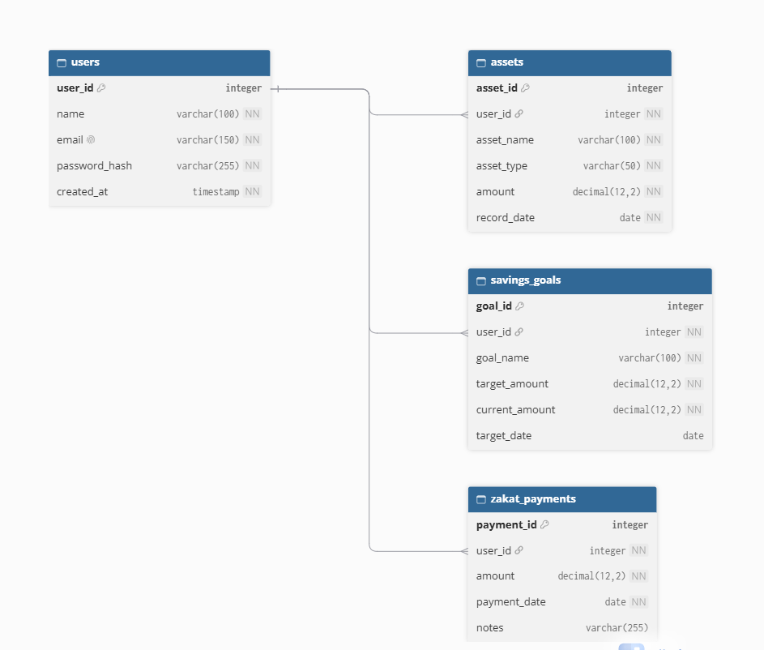
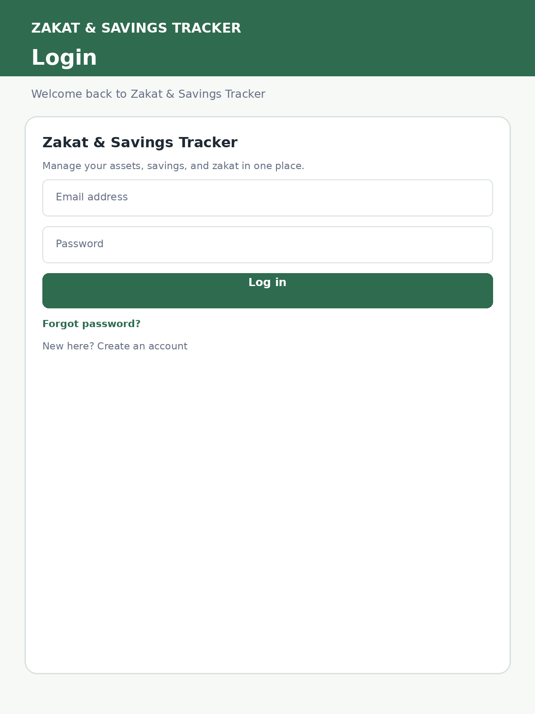
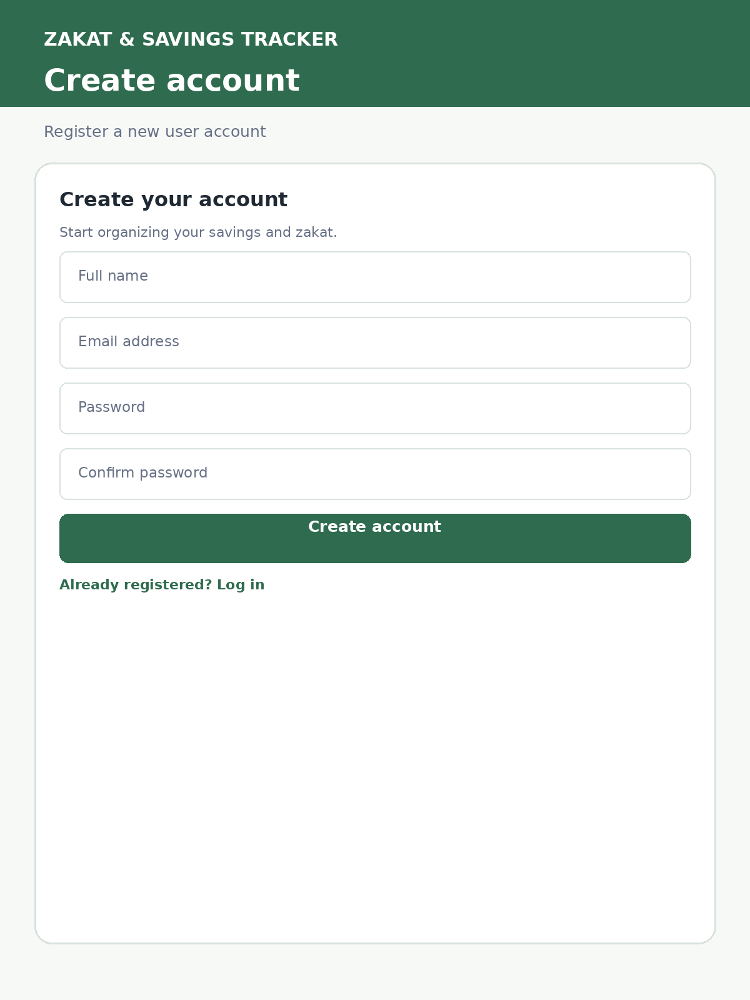
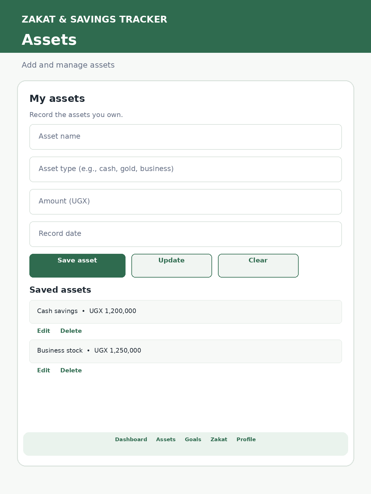
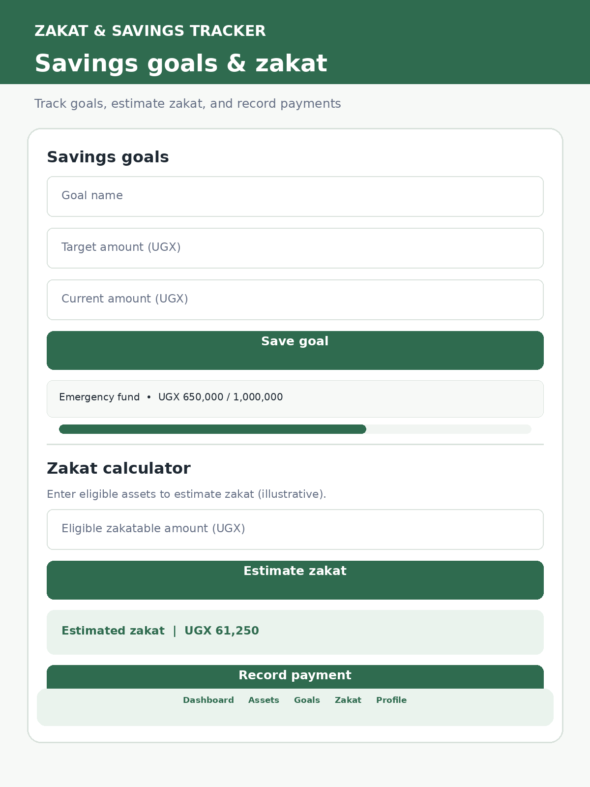

# Zakat & Savings Tracker
## System Analysis and Design Document

**Project Name:** Zakat & Savings Tracker

**Project Type:** Mobile Application

**Mobile Technology:** Flutter and Dart

**Backend:** REST API

**Database:** Relational Database

**Group Members:**
- Ebaa Ali
- Luksa Harunah Talha
- Ntarambirwa Fidele

**Course:** Mobile App Development Capstone

**Lecturer:** Dr. Matsiko
---

## 1. Problem Statement

Managing personal assets, savings goals, and zakat payment records can be difficult when financial information is stored in different places or recorded manually. This can make it harder for users to monitor their savings progress, maintain organised records, and review previous zakat payments.

The Zakat & Savings Tracker is a mobile application designed to help users manage their financial information in one place. Users will be able to create an account, securely log in, record their assets, set savings goals, estimate their zakat based on the information and calculation settings provided, and record zakat payments.

The application will use Flutter and Dart for the mobile interface, a REST API for communication with the backend, and a relational database to store information. Each user will only be able to access their own financial records.

The goal is to provide a convenient and organised way to track savings and financial records. Zakat calculations will be estimates and will not replace guidance from a qualified religious authority.

## 2. Users and Goals

### 2.1 Target Users

The application is designed for individuals who want to organise their financial records, track savings goals, and keep records of their zakat payments.

### 2.2 User Goals

Users should be able to:

1. Register an account and log in securely.
2. Add, view, update, and delete their asset records.
3. Create and manage savings goals.
4. Track progress towards their savings targets.
5. View an estimated zakat amount based on their recorded information and calculation settings.
6. Record and review zakat payments.
7. Access their financial records securely and privately.

## 3. System Requirements

### 3.1 Functional Requirements

1. The system shall allow users to register an account using their name, email, and password.
2. The system shall allow registered users to log in securely.
3. The system shall allow users to log out of their accounts.
4. The system shall allow users to add new asset records.
5. The system shall allow users to view their recorded assets.
6. The system shall allow users to update existing asset records.
7. The system shall allow users to delete asset records.
8. The system shall allow users to create, view, update, and delete savings goals.
9. The system shall calculate an estimated zakat amount based on financial information and calculation settings.
10. The system shall allow users to record and view zakat payments.
11. The system shall ensure that users can access only their own financial records.
12. The system shall validate user input and display appropriate error messages.

### 3.2 Non-Functional Requirements

1. **Security:** The system shall protect user accounts by hashing passwords and securing access to private records.
2. **Usability:** The system shall provide a clear and simple interface that users can navigate easily.
3. **Reliability:** The system shall display appropriate error messages when requests fail or the backend is unavailable.
4. **Performance:** The system shall respond to normal user requests within a reasonable time under typical usage conditions.

 ## 4. User Stories

1. As a user, I want to register an account so that I can use the application.
2. As a registered user, I want to log in securely so that my financial records remain private.
3. As a user, I want to add asset records so that I can track my assets.
4. As a user, I want to view my assets so that I can review my financial information.
5. As a user, I want to update asset records so that I can correct or change information.
6. As a user, I want to delete asset records so that I can remove information I no longer need.
7. As a user, I want to create savings goals so that I can plan my savings.
8. As a user, I want to track my savings progress so that I can see how close I am to my targets.
9. As a user, I want to estimate my zakat based on my financial information so that I can plan my zakat obligations.
10. As a user, I want to record zakat payments so that I can keep a history of payments.
11. As a user, I want to view my previous zakat payments so that I can review my records.
12. As a user, I want to log out so that my account is not left open on a shared device.

## 5. Database Design (ERD)

The database will contain four main entities: users, assets, savings_goals, and zakat_payments. Each user can have multiple asset records, multiple savings goals, and multiple zakat payment records.

### 5.1 Entity 1: users

- user_id: INTEGER, Primary Key, auto-increment
- name: VARCHAR(100), NOT NULL
- email: VARCHAR(150), UNIQUE, NOT NULL
- password_hash: VARCHAR(255), NOT NULL
- created_at: DATETIME, NOT NULL

### 5.2 Entity 2: assets

- asset_id: INTEGER, Primary Key, auto-increment
- user_id: INTEGER, Foreign Key references users(user_id)
- asset_name: VARCHAR(100), NOT NULL
- asset_type: VARCHAR(50), NOT NULL
- amount: DECIMAL(12,2), NOT NULL
- record_date: DATE, NOT NULL

### 5.3 Entity 3: savings_goals

- goal_id: INTEGER, Primary Key, auto-increment
- user_id: INTEGER, Foreign Key references users(user_id)
- goal_name: VARCHAR(100), NOT NULL
- target_amount: DECIMAL(12,2), NOT NULL
- current_amount: DECIMAL(12,2), NOT NULL, default 0
- target_date: DATE, nullable

### 5.4 Entity 4: zakat_payments

- payment_id: INTEGER, Primary Key, auto-increment
- user_id: INTEGER, Foreign Key references users(user_id)
- amount: DECIMAL(12,2), NOT NULL
- payment_date: DATE, NOT NULL
- notes: VARCHAR(255), nullable

### 5.5 Relationships and Cardinality

1. One user can have many assets (1:N).
2. One user can have many savings goals (1:N).
3. One user can have many zakat payment records (1:N).

Each asset, savings goal, and zakat payment record belongs to one user through the user_id foreign key.

### 5.6 Normalisation

The database is designed to follow Third Normal Form (3NF). Each table represents one main entity, each table has a primary key, and user information is stored separately from assets, savings goals, and zakat payments. This reduces unnecessary duplication and helps maintain data consistency.

### 5.7 ERD Diagram

The following Entity Relationship Diagram illustrates the four database entities and their relationships.



## 6. Data Dictionary

The data dictionary describes the fields, data types, constraints, and meanings of the database tables.

### 6.1 Users Table

| Field | Data Type | Constraints | Description |
|---|---|---|---|
| user_id | INTEGER | Primary Key, Auto-increment | Unique user identifier |
| name | VARCHAR(100) | NOT NULL | User's full name |
| email | VARCHAR(150) | UNIQUE, NOT NULL | User's email address |
| password_hash | VARCHAR(255) | NOT NULL | Hashed password |
| created_at | DATETIME | NOT NULL | Account creation date and time |

### 6.2 Assets Table

| Field | Data Type | Constraints | Description |
|---|---|---|---|
| asset_id | INTEGER | Primary Key, Auto-increment | Unique asset identifier |
| user_id | INTEGER | Foreign Key, NOT NULL | Owner of the asset |
| asset_name | VARCHAR(100) | NOT NULL | Name or description of the asset |
| asset_type | VARCHAR(50) | NOT NULL | Category of the asset |
| amount | DECIMAL(12,2) | NOT NULL | Recorded asset value |
| record_date | DATE | NOT NULL | Date the asset was recorded |

### 6.3 Savings Goals Table

| Field | Data Type | Constraints | Description |
|---|---|---|---|
| goal_id | INTEGER | Primary Key, Auto-increment | Unique savings goal identifier |
| user_id | INTEGER | Foreign Key, NOT NULL | Owner of the goal |
| goal_name | VARCHAR(100) | NOT NULL | Name of the savings goal |
| target_amount | DECIMAL(12,2) | NOT NULL | Desired savings amount |
| current_amount | DECIMAL(12,2) | NOT NULL, DEFAULT 0 | Current saved amount |
| target_date | DATE | NULL allowed | Planned completion date |

### 6.4 Zakat Payments Table

| Field | Data Type | Constraints | Description |
|---|---|---|---|
| payment_id | INTEGER | Primary Key, Auto-increment | Unique payment identifier |
| user_id | INTEGER | Foreign Key, NOT NULL | User who recorded the payment |
| amount | DECIMAL(12,2) | NOT NULL | Amount of zakat paid |
| payment_date | DATE | NOT NULL | Date of payment |
| notes | VARCHAR(255) | NULL allowed | Optional payment notes |


## 7. API Endpoint Documentation

The application will use a REST API to exchange data between the Flutter mobile application and the backend. Data will be sent and received in JSON format. Users must be authenticated before accessing their private financial records. Each authenticated user can access and manage only their own records.

| Method | Endpoint | Purpose | Request Body | Expected Response |
|---|---|---|---|---|
| POST | `/api/auth/register` | Register a new user | `name`, `email`, `password` | User details and success message |
| POST | `/api/auth/login` | Authenticate a user | `email`, `password` | Access token and user details |
| GET | `/api/assets` | Retrieve all assets belonging to the authenticated user | None | List of assets |
| POST | `/api/assets` | Create a new asset for the authenticated user | `asset_name`, `asset_type`, `amount`, `record_date` | Created asset details |
| GET | `/api/assets/{asset_id}` | Retrieve one asset belonging to the authenticated user | None | Asset details |
| PUT | `/api/assets/{asset_id}` | Update an asset belonging to the authenticated user | Updated asset fields | Updated asset details |
| DELETE | `/api/assets/{asset_id}` | Delete an asset belonging to the authenticated user | None | Confirmation message |
| GET | `/api/savings-goals` | Retrieve all savings goals belonging to the authenticated user | None | List of savings goals |
| POST | `/api/savings-goals` | Create a new savings goal for the authenticated user | `goal_name`, `target_amount`, `current_amount`, `target_date` | Created savings goal details |
| GET | `/api/savings-goals/{goal_id}` | Retrieve one savings goal belonging to the authenticated user | None | Savings goal details |
| PUT | `/api/savings-goals/{goal_id}` | Update a savings goal belonging to the authenticated user | Updated goal fields | Updated savings goal details |
| DELETE | `/api/savings-goals/{goal_id}` | Delete a savings goal belonging to the authenticated user | None | Confirmation message |
| POST | `/api/zakat/estimate` | Calculate an estimated zakat amount based on the user's eligible assets and applicable calculation settings | Relevant financial amounts and calculation settings | Estimated zakat amount and calculation summary |
| GET | `/api/zakat-payments` | Retrieve zakat payment history belonging to the authenticated user | None | List of zakat payment records |
| POST | `/api/zakat-payments` | Record a zakat payment for the authenticated user | `amount`, `payment_date`, `notes` | Created zakat payment details |

### 7.1 API Security and Validation

The API will follow these security and validation principles:

- Passwords will be securely hashed before being stored in the database.
- Successful login will return an access token for authenticated requests.
- Protected endpoints will require valid authentication.
- The backend will verify that users can access or modify only their own records.
- The backend will validate submitted data, including required fields, valid amounts, and appropriate date formats.
- The API will return suitable HTTP status codes and error messages for successful requests, invalid input, unauthorized access, missing records, and other errors.

### 7.2 Sample API Request

The following example shows a request to create a new asset:

```json
{
  "asset_name": "Personal Savings",
  "asset_type": "Cash",
  "amount": 500000,
  "record_date": "2026-10-24"
}
```

### 7.3 Sample API Response

The following example shows a successful response after creating an asset:

```json
{
  "asset_id": 1,
  "asset_name": "Personal Savings",
  "asset_type": "Cash",
  "amount": 500000,
  "record_date": "2026-10-24"
}
```

These examples illustrate the expected JSON structure. The actual responses will depend on the backend implementation. The backend will associate each record with the authenticated user and validate submitted values before saving them.

### 7.4 Zakat Calculation Note

The zakat estimate endpoint will use the financial information supplied by the user and the applicable calculation settings to produce an estimated amount. The calculation should account for the applicable nisab threshold and zakat rate, while clearly explaining any assumptions used. Users should be able to review the estimate before recording a zakat payment. The estimate and payment history are separate functions: calculating an estimate does not automatically record a payment.

## 8. Screen Sketches

The application will use a simple and user-friendly interface. The following sketches describe the main screens planned for the Flutter mobile application.

### 8.1 Login Screen

- Application name and logo.
- Email input field.
- Password input field.
- Login button.
- Link to the registration screen.
- Error message area for invalid login details.

### 8.2 Registration Screen

- Full name input field.
- Email input field.
- Password input field.
- Confirm password input field.
- Register button.
- Link to the login screen.

### 8.3 Dashboard Screen

- Welcome message for the logged-in user.
- Summary of recorded assets.
- Savings goals summary and progress.
- Estimated zakat summary.
- Navigation to Assets, Savings Goals, Zakat Payments, and Profile.

### 8.4 Assets Screen

- List of the user's recorded assets.
- Button to add a new asset.
- Input fields for asset name, asset type, amount, and record date.
- Buttons to save, edit, and delete asset records.
- Validation messages for incorrect entries.

### 8.5 Savings Goals and Zakat Payments Screens

The Savings Goals screen will allow users to create goals, enter target amounts, update current savings, and view progress towards each goal.

The Zakat Payments screen will allow users to record a payment amount, enter the payment date, add optional notes, and view their previous payment records.

The final screen layouts will be designed to support clear navigation, readable information, and convenient data entry.

### 8.6 Zakat Payment History Screen

The payment history screen will allow users to review their previously recorded zakat payments.

**Main elements:**
- Payment amount
- Payment date
- Optional payment notes
- List of previous zakat payments
- Option to record a new payment

### 8.7 Screen Wireframes

The following images illustrate the planned user interface of the application.

#### 8.7.1 Login Screen



#### 8.7.2 Registration Screen



#### 8.7.3 Assets Screen



#### 8.7.4 Savings Goals and Zakat Screen


